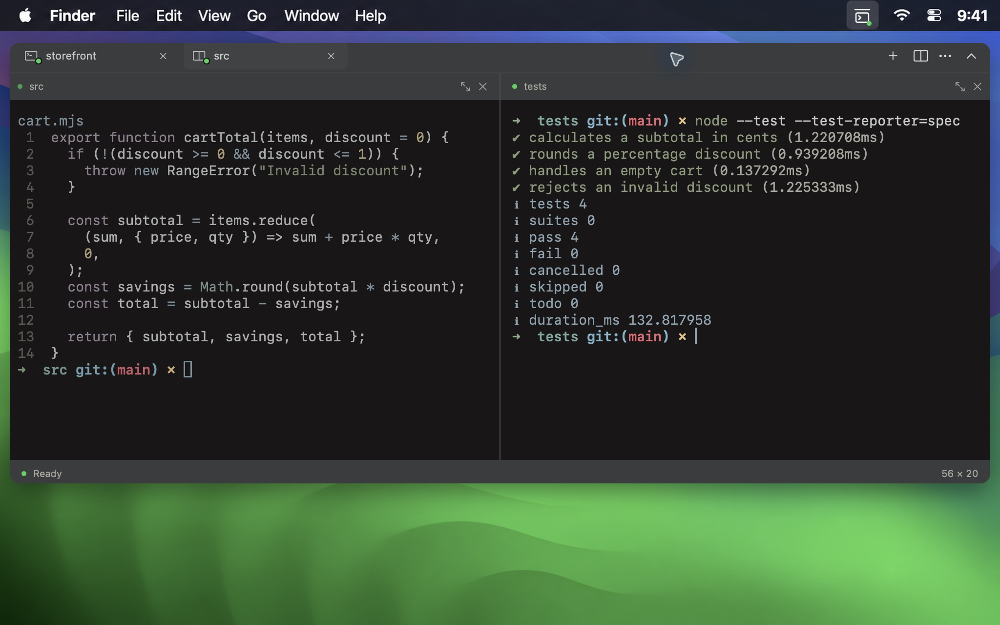

<div align="center">


# term-cut — macOS Menu Bar Terminal

[](https://github.com/berkinduz/term-cut-menubar-terminal/actions/workflows/ci.yml)

**Your terminal. One shortcut away.**

A free, open-source terminal for Mac that lives in your menu bar.
Float a window beside your work, or pull a terminal down from the top of your screen. Your tabs, panes, and running commands stay with you.

[Download DMG](https://github.com/berkinduz/term-cut-menubar-terminal/releases/latest/download/term-cut.dmg) · [Features](#features) · [Build from source](#build-from-source) · [Shortcuts](#shortcuts)

</div>

## Two ways to work

### Floating Window

A movable, resizable window for working beside your editor or browser. Open with `⌃⌥Space`.


### Top Drawer

A wide terminal that opens from the top of your screen and hides when you are done. Open with `` ⌃⌥` ``.



Choose a mode from **More options (⋯)**, the **View** menu, or the menu bar icon's right-click menu. Both modes share the same sessions: a running command keeps running while you switch or hide the terminal. Set each mode's size and shortcut in Settings.

## Features

- **Always within reach.** Open from the menu bar or a customizable global keyboard shortcut. Choose Floating Window or Top Drawer from **More options (⋯)** or the **View** menu.
- **Room to work.** Tabs, resizable split panes, pane focus, and search.
- **Sessions that stay.** Hide the window or switch layouts while commands keep running.
- **Status at a glance.** Small green, yellow, and red dots show ready, running, and failed commands in the menu bar, tabs, and panes.
- **Quiet by design.** A thin row of tabs and controls, translucent window bars, and an unobstructed terminal canvas. Scroll through your history with a mouse wheel or trackpad.
- **Make it yours.** Kanagawa Dragon by default, plus other themes, installed monospaced fonts, cursors, sizes, window proportions, scrollback, Meta keys, and startup behavior.
- **A real terminal.** Your login shell, true color, Unicode, and interactive command-line tools. Powered by [SwiftTerm](https://github.com/migueldeicaza/SwiftTerm).

### Tabs and split panes

Keep separate tasks in tabs, split a workspace horizontally or vertically, and focus one pane when you need more room. Each tab remembers its selected pane. Labels show the folder name, with **Home** and **Root** for those locations; hover over a tab or pane label for its full path and shell title. Right-click a tab to give it a name such as `server` or `tests`. The status bar keeps activity and terminal dimensions in view.

### Settings

Search settings by name, from themes and font sizes to window proportions and keyboard shortcuts. Kanagawa Dragon pairs warm charcoal with muted terminal colors.

## Install on macOS

[Download the latest release](https://github.com/berkinduz/term-cut-menubar-terminal/releases/latest/download/term-cut.dmg), open the disk image, and drag **term-cut** into **Applications**. Requires macOS 13 or later; supports Apple silicon and Intel.

Releases are ad-hoc signed without Apple notarization. On first launch, macOS may require approval in **System Settings → Privacy & Security**. Building from source is also supported.

## Build from source

Requires **macOS 13+** and **Xcode 26+** with its command-line tools selected.

```sh
git clone https://github.com/berkinduz/term-cut-menubar-terminal.git
cd term-cut-menubar-terminal
./scripts/build-app.sh
open build/term-cut.app
```

Drag `build/term-cut.app` into Applications. Open **More options (⋯)** in the terminal for window modes, Settings, About, and **Keep visible when switching apps**. You can also switch modes from the **View** menu or your global shortcuts. To create an Apple silicon + Intel build, add `--universal`. To package a disk image, run `./scripts/package-dmg.sh`.

## Shortcuts

| Action | Shortcut |
| --- | --- |
| Toggle Floating Window | `⌃⌥Space` |
| Toggle Top Drawer | `` ⌃⌥` `` |
| New tab | `⌘T` |
| Split right / down | `⌘D` / `⇧⌘D` |
| Next / previous pane | `⌘]` / `⌘[` |
| Focus / restore pane | `⇧⌘Return` |
| Next / previous tab | `⌃Tab` / `⌃⇧Tab` |
| Find | `⌘F` |
| Close pane / tab | `⌘W` / `⇧⌘W` |
| Hide terminal | `⇧⌘H` |
| Settings | `⌘,` |

Global shortcuts can be changed in Settings. Escape stays available to your shell and editors. Sessions last until you close them or quit the app; they are not restored after quitting. Working-directory inheritance requires shell OSC 7 support.

Closing a pane or tab, or quitting the app, asks for confirmation when a command or background job is still running. Cancelling leaves the sessions open.

The menu bar reopens the current window mode, including after a macOS permission dialog. Your last mode is also remembered when you quit and reopen the app. Switch modes from the toolbar, **Settings → Window mode**, or global shortcuts.

## Activity indicators

Automatic command tracking supports your top-level **zsh** login shell. Its normal startup files still load; term-cut does not edit them. Green means ready, yellow means a foreground command is running, and red means the last command returned a nonzero exit status. A new command replaces that status. The menu bar gives failed sessions priority across all tabs and panes, including hidden ones.

Gray means the session ended or activity tracking is unavailable. Other shells, commands inside nested shells or interactive SSH sessions, and background jobs are not individually tracked. Output text alone never determines success or failure. See [shell integration](docs/SHELL_INTEGRATION.md) for details.

## Contribute

Open `Package.swift` in Xcode, or work from the command line:

```sh
swift test
./scripts/build-app.sh
```

Small, focused improvements are welcome. [Open an issue](https://github.com/berkinduz/term-cut-menubar-terminal/issues) for bugs or ideas.

Release maintainers: see [Releasing](docs/RELEASING.md).

[MIT License](LICENSE) · Made by [berkinduz](https://github.com/berkinduz) · [Contact](mailto:mberkinduz@gmail.com)
