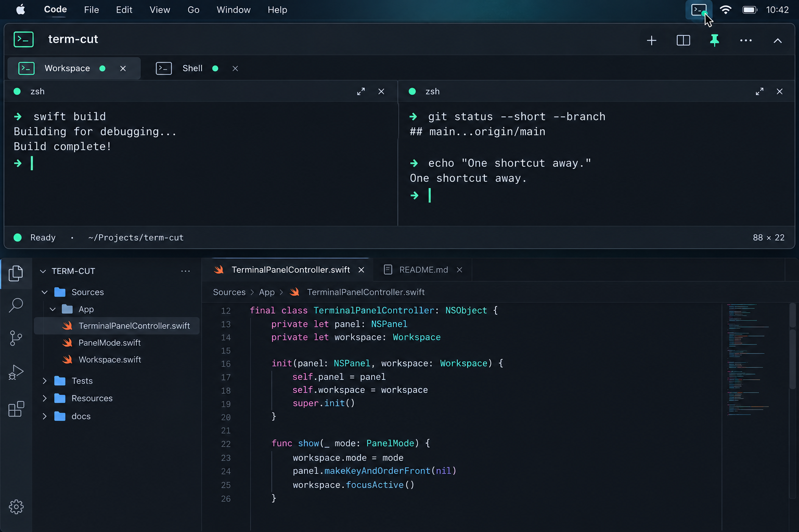
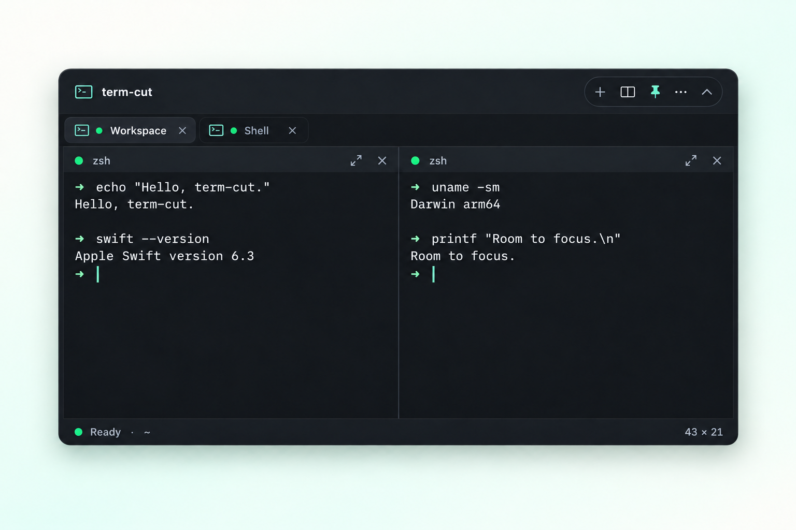
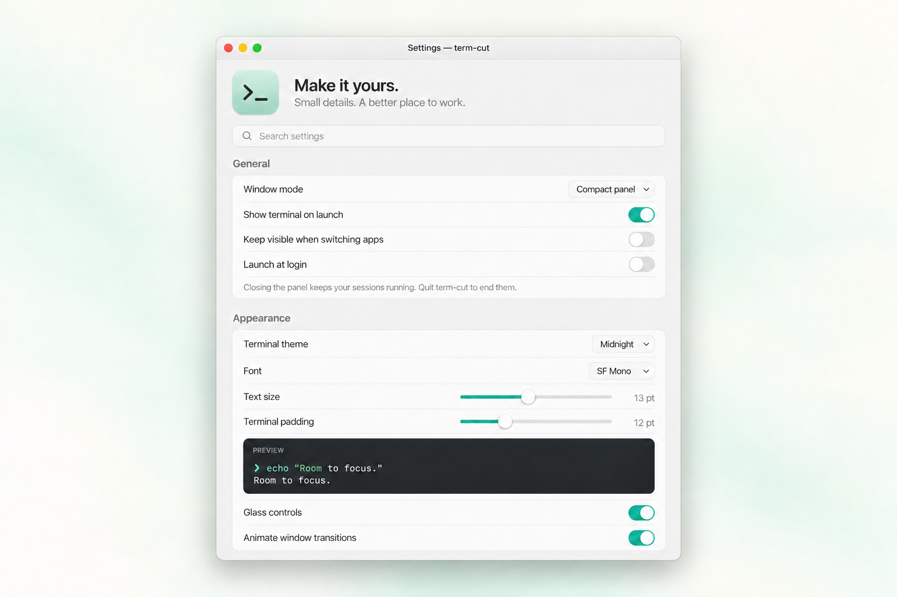

<div align="center">

# term-cut — macOS Menu Bar Terminal

[](https://github.com/berkinduz/term-cut-menubar-terminal/actions/workflows/ci.yml)

**Your terminal. One shortcut away.**

A free, open-source terminal for Mac that lives in your menu bar.
Open your shell with a global hotkey, work across tabs and split panes, and keep your flow.

[Download for Mac](https://github.com/berkinduz/term-cut-menubar-terminal/releases/latest/download/term-cut.dmg) · [Features](#features) · [Build from source](#build-from-source) · [Shortcuts](#shortcuts)

</div>



*Open from the menu bar or a global shortcut.*

## Features

- **Always within reach.** Open from the menu bar or a customizable global keyboard shortcut. Choose a floating panel or a drop-down terminal from **⋯ → Window Mode**.
- **Room to work.** Tabs, resizable split panes, pane focus, and search.
- **Sessions that stay.** Hide the window or switch layouts while commands keep running.
- **Status at a glance.** Small green, yellow, and red dots show ready, running, and failed commands in the menu bar, tabs, and panes.
- **Quiet by design.** Native controls, considered colors, gentle transitions, and Liquid Glass on macOS 26+.
- **Make it yours.** Themes, installed monospaced fonts, cursors, sizes, window proportions, scrollback, Meta keys, and startup behavior.
- **A real terminal.** Your login shell, true color, Unicode, and interactive command-line tools. Powered by [SwiftTerm](https://github.com/migueldeicaza/SwiftTerm).

### Tabs and split panes



### Settings



## Install on macOS

[Download the latest release](https://github.com/berkinduz/term-cut-menubar-terminal/releases/latest/download/term-cut.dmg), open the disk image, and drag **term-cut** into **Applications**. Requires macOS 13 or later; supports Apple silicon and Intel.

Releases are ad-hoc signed without Apple notarization. On first launch, macOS may require approval in **System Settings → Privacy & Security**. Building from source is also supported.

## Build from source

Requires **macOS 13+** and **Xcode 26+** with its command-line tools selected.

```sh
git clone https://github.com/berkinduz/term-cut-menubar-terminal.git
cd term-cut-menubar-terminal
./scripts/build-app.sh
open build/term-cut.app
```

Drag `build/term-cut.app` into Applications. Open **More options (⋯)** in the terminal for Settings, About, and **Window Mode**. You can also switch modes from the **View** menu or your global shortcuts. To create an Apple silicon + Intel build, add `--universal`. To package a disk image, run `./scripts/package-dmg.sh`.

## Shortcuts

| Action | Shortcut |
| --- | --- |
| Toggle compact panel | `⌃⌥Space` |
| Toggle drop-down | `` ⌃⌥` `` |
| New tab | `⌘T` |
| Split right / down | `⌘D` / `⇧⌘D` |
| Next / previous pane | `⌘]` / `⌘[` |
| Focus / restore pane | `⇧⌘Return` |
| Next / previous tab | `⌃Tab` / `⌃⇧Tab` |
| Find | `⌘F` |
| Close pane / tab | `⌘W` / `⇧⌘W` |
| Hide terminal | `⇧⌘H` |
| Settings | `⌘,` |

Global shortcuts can be changed in Settings. Escape stays available to your shell and editors. Sessions last until you close them or quit the app; they are not restored after quitting. Working-directory inheritance requires shell OSC 7 support.

The menu bar reopens the current window mode, including after a macOS permission dialog. Your last mode is also remembered when you quit and reopen the app. Switch modes from **Settings → Window mode**, global shortcuts, or **⋯ → Window Mode**.

## Activity indicators

Automatic command tracking supports your top-level **zsh** login shell. Its normal startup files still load; term-cut does not edit them. Green means ready, yellow means a foreground command is running, and red means the last command returned a nonzero exit status. A new command replaces that status. The menu bar gives failed sessions priority across all tabs and panes, including hidden ones.

Gray means the session ended or activity tracking is unavailable. Other shells, commands inside nested shells or interactive SSH sessions, and background jobs are not individually tracked. Output text alone never determines success or failure. See [shell integration](docs/SHELL_INTEGRATION.md) for details.

## Contribute

Open `Package.swift` in Xcode, or work from the command line:

```sh
swift test
./scripts/build-app.sh
```

Small, focused improvements are welcome. [Open an issue](https://github.com/berkinduz/term-cut-menubar-terminal/issues) for bugs or ideas.

Release maintainers: see [Releasing](docs/RELEASING.md).

[MIT License](LICENSE) · Made by [berkinduz](https://github.com/berkinduz) · [Contact](mailto:mberkinduz@gmail.com)
