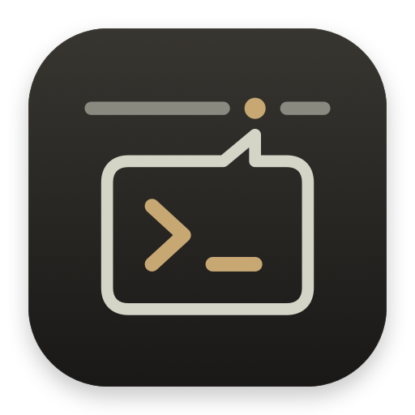
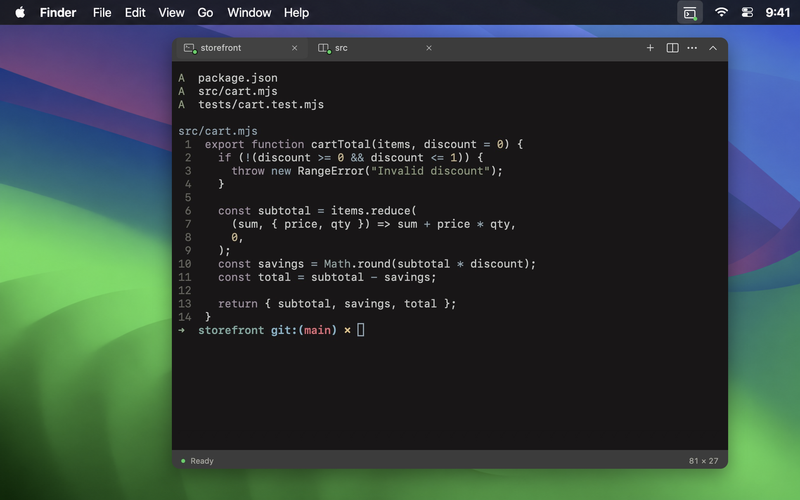

<div align="center">



# Peeksh

**Your terminal. A click away.**

A native macOS terminal that lives in your menu bar.

</div>



Click the menu bar icon to open your terminal. Run a command, hide the window, and keep your sessions running until you need them again. Resize or move it to fit your workspace; Peeksh remembers your chosen size and position.

- **Room to work.** Tabs, split panes, and saved project layouts.
- **Pick up where you left off.** Restore your folders and workspace when you relaunch.
- **Make it yours.** Themes, fonts, and optional command-completion notifications.

## Install

```sh
brew tap berkinduz/tap https://github.com/berkinduz/tap
brew install --cask berkinduz/tap/peeksh
```

Or download **Peeksh.dmg** from [Releases](https://github.com/berkinduz/peeksh/releases) and drag **Peeksh** into **Applications**.

Requires **macOS 13+**. Supports Apple silicon and Intel.

[Build from source](docs/RELEASING.md#prepare-locally) · [MIT License](LICENSE) · Made by [berkinduz](https://github.com/berkinduz)
